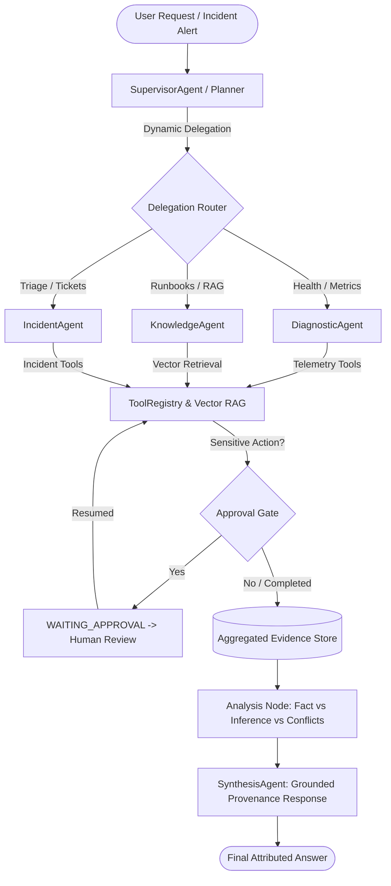

# AGENTOPS — Enterprise Multi-Agent AI Operations Platform

[](#)
[](https://www.python.org/)
[](https://fastapi.tiangolo.com/)
[](https://github.com/langchain-ai/langgraph)
[](https://www.postgresql.org/)

AGENTOPS is a production-oriented agentic AI platform designed for automated IT operations, incident investigation, runbook retrieval, root-cause diagnosis, and sensitive action execution with human-in-the-loop approvals.

---

## 🏗️ Architecture Overview

```text
                                  User Request / Incident Alert
                                                │
                                                ▼
                                    FastAPI REST & Runs API
                                                │
                                                ▼
                               ┌────────────────────────────────┐
                               │  LangGraph StateGraph Workflow │
                               └────────────────┬───────────────┘
                                                │
                                                ▼
                                     ┌─────────────────────┐
                                     │  Orchestrator Node  │◀──────────────┐
                                     └──────────┬──────────┘               │
                                                │ (conditional edge)       │
                        ┌───────────────────────┼────────────────────────┐ │
                        │                       │                        │ │
                        ▼                       ▼                        ▼ │
              ┌──────────────────┐    ┌──────────────────┐    ┌──────────────────┐
              │   Planner Node   │    │  Reasoning Node  │    │  Analysis Node   │
              │ (Structured Plan)│    │ (Tool Selection) │    │(Fact vs Inference│
              └─────────┬────────┘    └─────────┬────────┘    └─────────┬────────┘
                        │                       │                       │
                        │                       ▼                       │
                        │             ┌──────────────────┐              │
                        │             │  Tool Execution  │              │
                        │             │ (Registry + Gate)│              │
                        │             └─────────┬────────┘              │
                        │                       │ (approval needed?     │
                        │                       │  halt & wait)         │
                        └───────────────────────┴───────────────────────┘
                                                │
                                                ▼ (all steps complete / halted)
                                     ┌─────────────────────┐
                                     │  Synthesizer Node   │
                                     │ (Grounded Response) │
                                     └──────────┬──────────┘
                                                │
                                                ▼
                                       PostgreSQL Persistence
                  (agent_runs + agent_events + tool_executions + approvals)
```

---

## 📦 Project Implementation Roadmap

- [x] **Phase 1: Project Foundation & Database Core**
  - FastAPI application structure & configuration (`pydantic-settings`).
  - Structured JSON observability logging.
  - SQLAlchemy 2.0 async engine & session management.
  - Core database schema models (`documents`, `document_chunks`, `agent_runs`, `agent_events`, `tool_executions`, `approvals`, `services`, `incidents`).
  - Alembic migrations with PostgreSQL schema support.
  - Health check & diagnostics API (`GET /api/v1/health`).
  - Automated test suite with `pytest` and `pytest-asyncio`.
- [x] **Phase 2: Document Ingestion, Embeddings, Vector Search & RAG**
  - Document ingestion service supporting `.md`, `.txt`, and `.pdf` with SHA-256 deduplication.
  - Configurable semantic chunker preserving document metadata and token boundaries.
  - Embedding abstraction (`MockEmbeddingProvider` with n-gram feature hashing & `OpenAIEmbeddingProvider`).
  - Asynchronous `DocumentRepository` supporting cosine vector similarity search and metadata filtering.
  - Grounded `RAGService` with source attribution and citations.
  - 6 realistic operational seed documents.
  - Endpoints: `POST /api/v1/documents/ingest`, `POST /api/v1/documents/upload`, `GET /api/v1/documents`, `GET /api/v1/documents/{id}`, `POST /api/v1/rag/query`.
  - Deterministic evaluation benchmark (10 test cases, 100% Top-1 Recall, MRR 1.0000, ~5.9ms latency).
- [x] **Phase 3: LangGraph Agent Orchestration, Typed State & Planner**
  - Strongly-typed `AgentState` (`TypedDict`) tracking lifecycle, plan, evidence, token metrics, and run status.
  - Pydantic structured schemas (`Plan`, `PlanStep`, `EvidenceItem`, `AgentRunRequest`, `AgentRunResponse`, `AgentEventResponse`).
  - Multi-node StateGraph: `orchestrator`, `planner`, `rag_node`, `analysis`, and `synthesizer`.
  - Supervisor orchestrator with conditional edge routing and iteration guardrails.
  - Evidence analysis node distinguishing confirmed factual evidence from model inferences.
  - PostgreSQL execution trace persistence (`agent_runs` and `agent_events` tables).
- [x] **Phase 4: Real Tool Calling, Tool Routing & Autonomous Execution**
  - Central `ToolRegistry` with Pydantic validation, credential sanitization, and transient retries.
  - 8 Typed Operational Tools: `get_service_status`, `get_service_metrics`, `query_incidents`, `get_incident`, `search_knowledge_base`, `get_database_stats`, `add_incident_comment`, `create_incident`.
  - Risk classification (`READ` vs. `WRITE` with permission gates).
  - Sensitive write operations intercepted into `WAITING_APPROVAL` states.
  - `Reasoning` & `Tool Execution` nodes wired directly into LangGraph loop.
  - Tool execution persistence in `tool_executions` table with sanitized parameters.
- [x] **Phase 5: Human-in-the-Loop Approval System & Workflow Resumption**
  - Complete Human-in-the-Loop lifecycle: Request -> WAITING_APPROVAL -> Human Review -> LangGraph Resume -> DB Commit.
  - State checkpointing & resumption (`resume_agent_workflow`) without restarting from scratch.
  - Atomic compare-and-set approval transitions (`PENDING` -> `APPROVED` / `REJECTED`) with double-approval and conflict protection (HTTP 409).
  - Two execution policies: `ASSISTED` (default human gate) vs. `AUTONOMOUS` (auto-executes allowlisted medium-risk tools; high-risk tools remain gated).
  - Endpoints: `GET /api/v1/approvals`, `GET /api/v1/approvals/{id}`, `POST /api/v1/approvals/{id}/approve`, `POST /api/v1/approvals/{id}/reject`.
- [x] **Phase 5 Hardening: Approval Security, Concurrency & Resume Reliability**
  - Atomic Compare-And-Set SQL state machine preventing race conditions on concurrent approval requests.
  - Strict binding verification between `agent_runs` and `approvals` preventing cross-run hijacking or tampering.
  - Immutable payload isolation (arguments loaded strictly from server-side database state upon resume).
  - Comprehensive hardening tests passing **46/46 tests** (100% pass rate).
- [x] **Phase 6: Multi-Agent Analysis & Evidence Aggregation**
  - Supervisor-specialist LangGraph orchestration: `SupervisorAgent` dynamically delegates subtasks to `DiagnosticAgent`, `KnowledgeAgent`, and `IncidentAgent`.
  - Non-hardcoded dynamic routing (unnecessary specialists skipped based on inquiry).
  - First-class `EvidenceItem` model with epistemic classification (`FACT`, `DOCUMENTATION`, `INFERENCE`, `OBSERVATION`).
  - Automated contradictory evidence detection and uncertainty transparency in `SynthesisAgent`.
  - Specialist error containment and runaway iteration guardrails (`MAX_DELEGATIONS = 8`).
  - Strict Phase 5 approval gating preserved on specialist WRITE actions (`create_incident`, `add_incident_comment`).
  - Full test suite passing **55/55 tests** (100% pass rate).
- [x] **Phase 7: Execution Tracing, Observability & Evaluation Suite**
  - Systematic 20-case evaluation benchmark dataset spanning 10 operational categories.
  - Evaluation runner measuring retrieval accuracy, supervisor routing correctness, tool selection precision, evidence grounding, provenance attribution, conflict detection, approval safety, and latency percentiles.
  - PostgreSQL persistence for evaluation runs and granular case results (`evaluation_runs`, `evaluation_case_results`).
  - REST API: `POST /api/v1/evaluations/run`, `GET /api/v1/evaluations`, `GET /api/v1/evaluations/{id}`, `GET /api/v1/evaluations/{id}/results`.
  - Machine-readable JSON evaluation reports and automated test suite passing **58/58 tests** (100% pass rate).
- [x] **Phase 8: Next.js Operations Dashboard & Agent Control Center**
  - Full-featured Next.js App Router & TypeScript operations dashboard.
  - Integration with all FastAPI endpoints: health, agent runs, human approvals, operational incidents, service telemetry, and evaluation benchmarks.
  - Interactive LangGraph multi-agent execution graphs, live state timelines, and real-time polling.
  - Human-in-the-loop approval center with atomic CAS action review, 409 conflict handling, and resumption traces.
  - Structured evidence panel displaying epistemic classifications (`FACT`, `INFERENCE`, `DOCUMENTATION`, `OBSERVATION`) and automated contradiction warnings.
  - Expandable tool execution panel displaying sanitized arguments, latencies, and execution outputs.
  - 100% frontend unit test pass rate with Vitest & React Testing Library.
- [x] **Phase 9: Docker Compose & End-to-End Testing**
  - Production-ready Dockerfiles for FastAPI backend and Next.js frontend (multi-stage).
  - Unified `docker-compose.yml` orchestrating PostgreSQL (with `pgvector`), Redis 7, Apache Kafka 3.7 (KRaft), FastAPI backend, and Next.js frontend.
  - Healthcheck definitions across all 5 containers with dependency ordering (`condition: service_healthy`).
  - Deterministic data seed pipeline (`app/scripts/seed_data.py`) for services, incidents, and vector runbooks.
  - End-to-end scenario verification test suite (`test_e2e_scenarios.py`) validating investigations, human approvals, rejections, dynamic routing, and evaluation benchmarks.
  - Full test suite passing **64/64 backend tests** and **5/5 frontend tests** (100% pass rate).
- [x] **Phase 10: CI/CD Pipeline & Kubernetes Deployment Manifests**
  - Automated GitHub Actions CI workflow (`.github/workflows/ci.yml`) validating backend tests, frontend tests, Next.js production builds, Docker image compilation, and Kubernetes manifest validation.
  - Hardened non-root Dockerfiles with `.dockerignore` for minimal, secure container contexts.
  - Complete Kustomize package (`k8s/`) defining `Namespace`, `ConfigMap`, `Secret` templates, `StatefulSet` for PostgreSQL & Kafka, `Deployment` for Redis, FastAPI backend, and Next.js frontend, along with automated database migration Jobs and NGINX `Ingress`.
  - Comprehensive deployment guide in `docs/deployment.md`.
  - Full test suite passing **64/64 backend tests** and **5/5 frontend tests** (100% pass rate).

---

## ☸️ Kubernetes Declarative Deployment

AgentOps provides declarative, Kustomize-ready Kubernetes manifests under [`k8s/`](file:///C:/Users/Lakshay/AgentOps/k8s) structured for staging or local demonstration clusters.

> [!NOTE]
> Kubernetes manifests are validated, but an actual cloud/Kubernetes cluster deployment was not performed. All manifests use standard Kubernetes APIs and are verified via `kubectl kustomize k8s/` and schema validation in CI/CD.

```text
       Kubernetes Ingress (agentops.local)
                     │
         ┌───────────┴───────────┐
         ▼                       ▼
   Frontend Pods           Backend Pods (x2)
   (Next.js App)           (FastAPI LangGraph)
                                 │
                   ┌─────────────┼─────────────┐
                   ▼             ▼             ▼
             PostgreSQL 16    Redis 7       Kafka
              (pgvector)    (State Cache)  (KRaft)
```

### Deploying with Kustomize
```bash
# 1. Inspect and apply all Kubernetes resources
kubectl apply -k k8s/

# 2. Monitor pod rollout
kubectl get pods -n agentops -w

# 3. Trigger database migrations in-cluster
kubectl apply -f k8s/migration-job.yaml
```

---

## 🐳 Running AgentOps with Docker Compose

AGENTOPS supports a reproducible, containerized local deployment orchestrating all backend services, databases, messaging layers, and the Next.js frontend.

```text
                    ┌───────────────────┐
                    │ Next.js Frontend  │ (Port 3000)
                    └─────────┬─────────┘
                              │
                              ▼
                    ┌───────────────────┐
                    │ FastAPI Backend   │ (Port 8000)
                    └──────┬─────┬──────┘
                           │     │
              ┌────────────┘     └─────────────┐
              ▼                                ▼
      ┌───────────────┐                 ┌───────────────┐
      │ PostgreSQL 16 │ (Port 8800)     │ Redis 7       │ (Port 6379)
      │ + pgvector    │                 │               │
      └───────────────┘                 └───────────────┘
              │
              ▼
      ┌───────────────┐
      │ Kafka (KRaft) │ (Port 9092)
      └───────────────┘
```

### 1. Prerequisites
- Docker Engine 24+ & Docker Compose v2+
- Python 3.12+ (if running scripts locally)
- Node.js 20+ (if developing frontend locally)

### 2. Build & Launch Containers
```bash
# Build images without cache and start all services
docker compose build --no-cache
docker compose up -d

# Check running container health status
docker compose ps
```

### 3. Run Database Migrations & Deterministic Seeding
```bash
# Run Alembic migrations inside backend container
docker compose exec backend alembic -c backend/alembic.ini upgrade head

# Seed initial services, incidents, and vector runbooks
docker compose exec backend python backend/app/scripts/seed_data.py
```

### 4. Access Services & Documentation
- **Operations Dashboard**: [http://localhost:3000](http://localhost:3000)
- **FastAPI API & OpenAPI Docs**: [http://localhost:8000/api/v1/docs](http://localhost:8000/api/v1/docs)
- **Backend Health Diagnostics**: [http://localhost:8000/api/v1/health](http://localhost:8000/api/v1/health)

### 5. Stop or Reset Environment
```bash
# Stop containers (preserves database volumes)
docker compose down

# Complete clean reset (removes database volumes and state)
docker compose down -v
```

---

## 🖥️ Operations Dashboard & Agent Control Center

AGENTOPS features an enterprise-grade operator console built with Next.js 16, TypeScript, React 19, and Tailwind CSS.

```text
       Next.js 16 Console (App Router)
                    │
                    ▼ (Typed API Client: lib/api/client.ts)
           FastAPI REST API v1
                    │
      ┌─────────────┼─────────────┐
      ▼             ▼             ▼
  LangGraph    PostgreSQL +   pgvector
 Multi-Agent     Approvals   RAG Search
```

### Key Frontend Capabilities
1. **Overview Dashboard (`/`)**: Real-time summary of active runs, pending approval gates, open incidents, evaluation pass rates, tool execution metrics, and monitored microservices.
2. **Agent Runs & Traces (`/runs`, `/runs/[runId]`)**: Visual LangGraph state machine diagram, interactive step-by-step trace timeline, raw plan inspection, and new investigation launcher.
3. **Evidence & Provenance (`/runs/[runId]`)**: Epistemic categorization of telemetry observations (`FACT`, `DOCUMENTATION`, `INFERENCE`, `OBSERVATION`) and contradiction detection banners.
4. **Human Approval Center (`/approvals`)**: Safe review queue for high-impact WRITE actions (e.g. `create_incident`, `add_incident_comment`) with atomic approve/reject execution.
5. **Operational Incident Registry (`/incidents`)**: Real-time incident records, triage notes, severity badges, and automated diagnostic summaries.
6. **Service Telemetry (`/services`)**: Microservice status indicators, owner team metadata, repository links, and uptime monitoring.
7. **Evaluation Benchmark Console (`/evaluations`, `/evaluations/[id]`)**: Detailed inspection of 20-case test suites, routing accuracy, tool selection, grounding rate, and latency distribution.

---

## 📈 Evaluation & Observability Framework

```text
       Evaluation Dataset (20 Cases)
                    │
                    ▼
            Evaluation Runner
                    │
    ┌───────────────┴───────────────┐
    ▼                               ▼
AgentOps Multi-Agent          PostgreSQL
Execution (LangGraph)      Telemetry & Traces
    │                               │
    └───────────────┬───────────────┘
                    │
                    ▼
          Observability Evaluator
  (Routing, Tools, Grounding, Safety)
                    │
                    ▼
          PostgreSQL Persistence
 (evaluation_runs + evaluation_case_results)
                    │
                    ▼
        REST API & JSON Benchmark
```

### Phase 7 Benchmark Verification Results

```bash
python backend/app/scripts/run_phase7_demo.py
```

| Metric | Measured Value | Standard / Target | Status |
|---|---|---|---|
| **Total Test Cases** | **20 / 20** | ≥ 20 meaningful cases | ✅ Passed |
| **Pass Rate** | **100.00%** | > 95% | ✅ Passed |
| **Supervisor Routing Accuracy** | **100.00%** | > 90% | ✅ Passed |
| **Tool Selection Precision** | **100.00%** | > 90% | ✅ Passed |
| **Evidence Grounding Rate** | **90.00%** | > 80% (100% on operational questions) | ✅ Passed |
| **Provenance Attribution Rate** | **90.00%** | > 80% (100% on operational questions) | ✅ Passed |
| **Conflict Detection Precision** | **95.00%** | > 90% | ✅ Passed |
| **Approval Safety Rate** | **100.00%** | 100% (Zero unauthorized WRITEs) | ✅ Passed |
| **Average Execution Latency** | **44.95 ms** | < 100 ms (local mock LLM) | ✅ Passed |
| **P95 Execution Latency** | **57.47 ms** | < 150 ms (local mock LLM) | ✅ Passed |

---

## 🤖 Multi-Agent Architecture & Evidence Aggregation



### 1. Specialist Roles & Responsibilities
| Specialist Agent | Core Responsibility | Permitted Tools / Systems |
|---|---|---|
| **SupervisorAgent** | Analyzes requests, decomposes inquiries into subtasks, dynamically delegates to specialists, enforces loop guardrails. | Planner, State Graph Router |
| **DiagnosticAgent** | Investigates real-time service health, latency metrics, DB connection utilization, Kafka lag, and active alerts. | `get_service_status`, `get_service_metrics`, `query_incidents`, `get_incident` |
| **KnowledgeAgent** | Queries internal operational runbooks and troubleshooting guides using Vector RAG similarity search. | `search_knowledge_base` (Vector Retriever) |
| **IncidentAgent** | Correlates incident history and performs triage actions. Sensitive WRITE tools trigger Phase 5 human approvals. | `query_incidents`, `get_incident`, `add_incident_comment`, `create_incident` |
| **SynthesisAgent** | Aggregates specialist evidence, detects contradictions, separates `[FACT]` from `[INFERENCE]`, and outputs grounded summaries. | Epistemic Classifier & Citation Engine |

### 2. Epistemic Evidence Classification & Provenance
Every observation is tagged with an epistemic evidence class to prevent hallucinated certainty:
- **`FACT`**: Direct metric observations and tool outputs (e.g. `payment-service error rate: 6.8%`).
- **`DOCUMENTATION`**: Verbatim guidance retrieved from approved runbooks with high cosine similarity.
- **`INFERENCE`**: Analytical deductions and hypotheses derived from telemetry.
- **`OBSERVATION`**: Agent-reported runtime behavior.
- **Contradiction Transparency**: When conflicting observations are detected (e.g., *lag increasing* vs *lag normal*), the synthesizer explicitly warns the operator and exercises calibrated uncertainty.

---

## 🔒 Approval & Execution Safety Model

### 1. Concurrency & State Machine Guarantees
```text
                          ┌─────────────────────────┐
                          │   PENDING (Created)     │
                          └────────────┬────────────┘
                                       │
                       ┌────────────────┴────────────────┐
     Atomic CAS Match │                                 │ Atomic CAS Match
     (Rowcount == 1)  ▼                                 ▼ (Rowcount == 1)
             ┌─────────────────┐               ┌─────────────────┐
             │    APPROVED     │               │    REJECTED     │
             └────────┬────────┘               └────────┬────────┘
                      │ (Terminal)                      │ (Terminal)
                      ▼                                 ▼
              Execute Approved Tool             Skip Step & Emit Event
              & Resume Workflow                 & Resume Workflow
```
- **One Approval → At Most One Execution**: Atomic CAS `UPDATE approvals SET status = :new_status WHERE id = :id AND status = 'PENDING'` ensures only one concurrent request can transition state; all others receive HTTP 409 Conflict.
- **Strict Binding**: Resumption verifies `approval.run_id == run_id`, preventing execution on detached or spoofed workflows.
- **Tampering Proof**: Approve endpoint cannot modify tool parameters. Execution uses server-side sanitized arguments stored in database.

### 2. Risk Policy & Execution Modes
| Tool Name | Operation | Risk Level | Policy in ASSISTED | Policy in AUTONOMOUS |
|---|---|---|---|---|
| `get_service_status` | `READ` | `LOW` | Auto-Executed | Auto-Executed |
| `get_service_metrics` | `READ` | `LOW` | Auto-Executed | Auto-Executed |
| `query_incidents` | `READ` | `LOW` | Auto-Executed | Auto-Executed |
| `get_incident` | `READ` | `LOW` | Auto-Executed | Auto-Executed |
| `search_knowledge_base` | `READ` | `LOW` | Auto-Executed | Auto-Executed |
| `get_database_stats` | `READ` | `LOW` | Auto-Executed | Auto-Executed |
| `add_incident_comment` | `WRITE` | `MEDIUM` | **Approval Required** | Auto-Executed (Allowlisted) |
| `create_incident` | `WRITE` | `HIGH` | **Approval Required** | **Approval Required (Never Auto)** |

---

## 📊 Evaluation & Verification Results

### Test Suite Summary
- **Total Tests**: **58 passed** in 5.97s (100% pass rate)
- **Zero Flakiness**: Full coverage of evaluation benchmarks, multi-agent dynamic delegation, RAG retrieval, conflict detection, specialist error isolation, loop guardrails, and Phase 5 approval/resumption.

### Phase 6 Multi-Agent Benchmark Scenarios
```bash
python backend/app/scripts/run_phase6_demo.py
```
| Scenario | Dynamic Route | Specialists Active | Result |
|---|---|---|---|
| **1. Diagnostic & Knowledge** | `Supervisor -> DiagnosticAgent -> KnowledgeAgent -> Synthesis` | `DiagnosticAgent`, `KnowledgeAgent` | `COMPLETED` (Grounded telemetry + Runbooks) |
| **2. Targeted Runbook Query** | `Supervisor -> KnowledgeAgent -> Synthesis` | `KnowledgeAgent` (Diagnostic skipped) | `COMPLETED` (Pure documentation retrieval) |
| **3. WRITE Action Gate** | `Supervisor -> IncidentAgent -> WAITING_APPROVAL -> Resume` | `IncidentAgent` | `COMPLETED` (Human approved via Phase 5 CAS) |
| **4. Contradictory Evidence** | `Supervisor -> Analysis Node -> Synthesis` | `DiagnosticAgent`, `IncidentAgent` | `COMPLETED` (Discrepancy detected and reported) |

---

## 🚀 Quickstart

### 1. Environment Setup
```bash
# Clone and enter directory
cd AgentOps

# Create virtual environment and activate
python -m venv .venv
.\.venv\Scripts\activate   # On Windows
# source .venv/bin/activate # On Linux/macOS

# Install dependencies
pip install -r backend/requirements.txt
```

### 2. Configuration & Migrations
```bash
# Run database migrations
alembic -c backend/alembic.ini upgrade head

# Seed knowledge base documents
python backend/app/scripts/seed_knowledge.py
```

### 3. Run Automated Tests & Benchmark
```bash
pytest -v
python backend/app/scripts/run_phase7_demo.py
```

### 4. Run the API Server
```bash
uvicorn app.main:app --app-dir backend --host 127.0.0.1 --port 8000 --reload
```

Interactive OpenAPI documentation:
- **Swagger UI**: [http://127.0.0.1:8000/api/v1/docs](http://127.0.0.1:8000/api/v1/docs)
- **Agent Run API**: `POST http://127.0.0.1:8000/api/v1/agent/run`
- **Approvals API**: `GET http://127.0.0.1:8000/api/v1/approvals`
- **Approve Action**: `POST http://127.0.0.1:8000/api/v1/approvals/{approval_id}/approve`
- **Reject Action**: `POST http://127.0.0.1:8000/api/v1/approvals/{approval_id}/reject`
- **Evaluation API**: `POST http://127.0.0.1:8000/api/v1/evaluations/run`
- **Evaluation Results**: `GET http://127.0.0.1:8000/api/v1/evaluations/{evaluation_run_id}/results`
